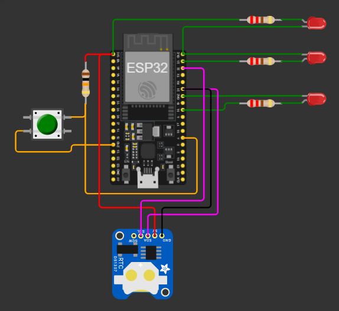

# relogio-ponto

Relógio de ponto com um botão. O ESP32 lê a hora de um RTC DS3231 e registra um timestamp a cada aperto; um programa em C++ no PC lê o CSV e soma as horas por dia e por mês. Projeto de estudo de eletrônica básica (resistor, pull-up, debounce, I²C) e C++ de baixo nível, feito para calcular as horas que eu trabalho.

## Circuito



| Componente | Ligação |
| --- | --- |
| Botão | GPIO 4 -> botão -> GND, pull-up de 10 kΩ ao 3V3 (apertado = LOW) |
| LED de status (pulso de 1 s a cada ponto) | GPIO 18 -> 150 Ω -> LED -> GND |
| LED de erro (pisca 3 vezes) | GPIO 23 -> 150 Ω -> LED -> GND |
| RTC DS1307 no Wokwi (DS3231 na placa real) | SDA = GPIO 21, SCL = GPIO 22, endereço `0x68` |

Contas do circuito: LED com 3,3 V e ~2 V de queda deixa 1,3 V no resistor, então 130 Ω dá 10 mA; uso 150 Ω (8,67 mA). Filtro RC do botão: 10 kΩ x 100 nF = 1 ms, por isso o debounce também é feito em software (50 ms).

## Stack

- Firmware: C++ (Arduino framework) no ESP32, PlatformIO
- RTC: RTClib, I²C
- Armazenamento: LittleFS
- Simulação: Wokwi
- Cálculo no PC: C++ puro (g++ do MSYS2, Windows)

## Estrutura

```
relogio-ponto/
├── firmware/relogio-ponto/   # projeto PlatformIO (ESP32) + código e foto do Wokwi
├── calc/                     # programa de cálculo de horas (PC)
├── samples/                  # CSVs de teste e resultados esperados (calculados na mão)
└── NOTAS.md                  # o que aprendi em cada fase
```

## Código (Wokwi)

```cpp
#include <Wire.h>
#include <RTClib.h>
#include <LittleFS.h>

constexpr uint8_t PIN_BUTTON = 4;
constexpr uint8_t PIN_LED_STATUS = 18;
constexpr uint8_t PIN_LED_ERROR = 23;
constexpr uint8_t PIN_BUZZER = 19;
constexpr unsigned long DEBOUNCE_MS = 50;
constexpr unsigned long PULSE_MS = 1000;
constexpr unsigned long ERROR_BLINK_MS = 300;
constexpr uint8_t ERROR_TOGGLES = 6;
constexpr size_t TIMESTAMP_SIZE = 26;

RTC_DS1307 rtc;

unsigned long lastButtonChangeMs = 0;
int previousButtonReading = HIGH;
bool statusLedOn = false;
unsigned long pulseStartMs = 0;
bool hasError = false;
bool errorLedOn = false;
uint8_t errorToggleCount = 0;
unsigned long lastErrorToggleMs = 0;

void formatTimestamp(char* out, size_t size, const DateTime& date) {
  snprintf(out, size, "%04d-%02d-%02dT%02d:%02d:%02d-03:00",
           date.year(), date.month(), date.day(),
           date.hour(), date.minute(), date.second());
}

bool buttonWasPressed(unsigned long now) {
  int reading = digitalRead(PIN_BUTTON);

  bool pressed = previousButtonReading == HIGH && reading == LOW &&
                 (now - lastButtonChangeMs) >= DEBOUNCE_MS;

  if (reading != previousButtonReading) {
    lastButtonChangeMs = now;
  }
  previousButtonReading = reading;

  return pressed;
}

void onPress(unsigned long now) {
  statusLedOn = true;
  pulseStartMs = now;

  char timestamp[TIMESTAMP_SIZE];
  formatTimestamp(timestamp, sizeof(timestamp), rtc.now());
  Serial.println(timestamp);

  digitalWrite(PIN_BUZZER, statusLedOn);
  digitalWrite(PIN_LED_STATUS, statusLedOn);
}

void updateStatusLed(unsigned long now) {
  if ((now - pulseStartMs) >= PULSE_MS) {
    statusLedOn = false;
  }
  digitalWrite(PIN_LED_STATUS, statusLedOn);
}

void updateErrorLed(unsigned long now) {
  if (hasError && errorToggleCount < ERROR_TOGGLES) {
    if ((now - lastErrorToggleMs) >= ERROR_BLINK_MS) {
      errorLedOn = !errorLedOn;
      errorToggleCount++;
      lastErrorToggleMs = now;
    }
  } else {
    hasError = false;
    errorLedOn = false;
  }

  digitalWrite(PIN_LED_ERROR, errorLedOn);
}

void setup() {
  Serial.begin(115200);

  pinMode(PIN_BUTTON, INPUT);
  pinMode(PIN_LED_STATUS, OUTPUT);
  pinMode(PIN_LED_ERROR, OUTPUT);

  Wire.begin();
  if (!rtc.begin()) {
    Serial.println("Erro achar o chip RTC");
    while (true) {}
  }

  if (!LittleFS.begin(true)) {
    hasError = true;
    Serial.println("Erro ao iniciar o LittleFS");
  } else {
    Serial.println("LittleFS ok");
  }
}

void loop() {
  const unsigned long now = millis();

  if (buttonWasPressed(now)) onPress(now);
  updateStatusLed(now);
  updateErrorLed(now);
}
```

## Como rodar

Cálculo (com g++ no PATH):

```bash
cd calc
g++ main.cpp -o calc && ./calc.exe ../samples/dia-normal.csv
```

Firmware: abrir `firmware/relogio-ponto` no VS Code com a extensão PlatformIO e rodar *Build*. Para simular, colar o código acima em um projeto ESP32 no [Wokwi](https://wokwi.com/), adicionar um DS1307 e montar o circuito da foto. As bibliotecas `RTClib` e `LittleFS` entram pelo gerenciador de bibliotecas do Wokwi.